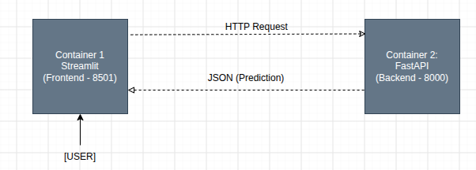
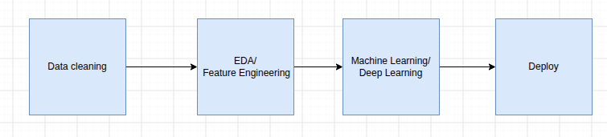
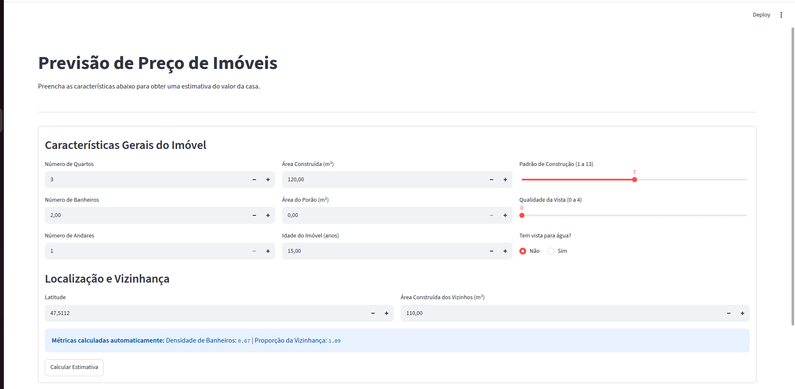
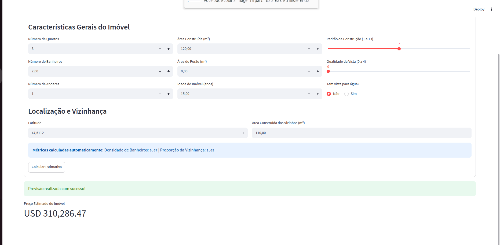
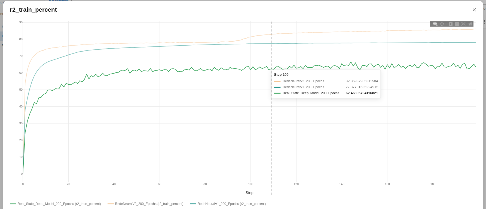
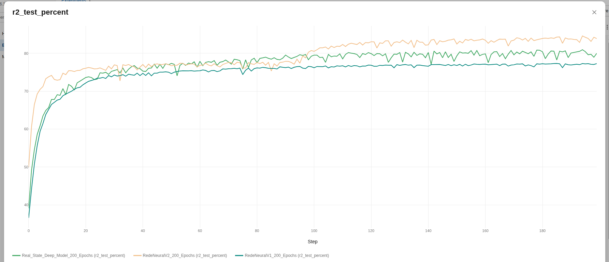
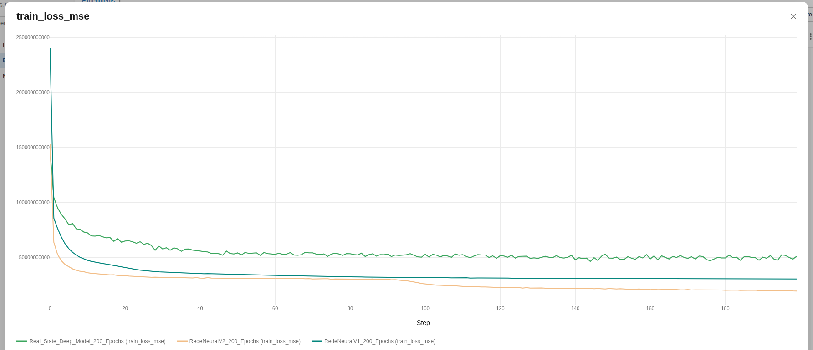
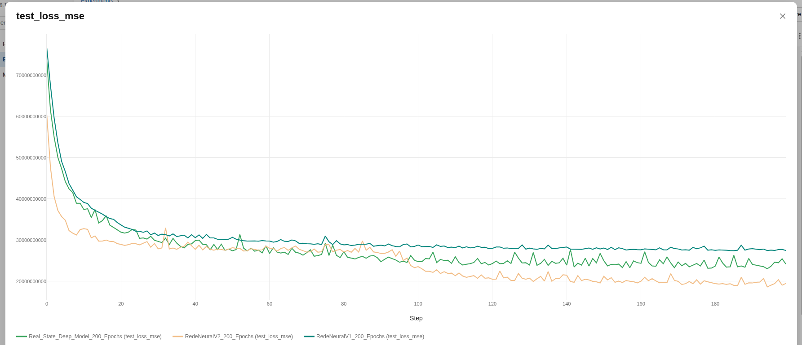

# Preditor de Preços de Imóveis

Um projeto de Machine Learning e Deep Learning que engloba todo o ciclo de vida dos dados: desde a limpeza e engenharia de atributos até a implantação de uma aplicação web conteinerizada com monitoramento de experimentos.

## Sobre o Projeto

Este projeto foi desenvolvido para prever o preço de imóveis com base no *Housing Prices Dataset*. O principal objetivo é demonstrar a construção de um pipeline completo de dados, passando pela análise exploratória, validação estatística, modelagem preditiva, e por fim, a produtização do modelo.

## Stack

**Ciência de Dados & Machine Learning:**
*   **Manipulação e Análise:** Pandas, NumPy
*   **Visualização:** Matplotlib, Plotly, Seaborn
*   **Machine Learning/Deep Learning:** Scikit-Learn, PyTorch
*   **Rastreamento de Experimentos:** MLflow

**MLOps:**
*   **Backend:** FastAPI
*   **Frontend:** Streamlit
*   **Orquestração e Deploy:** Docker, Docker Compose

---

## Arquitetura do Sistema & Workflow

A aplicação foi desenhada em uma arquitetura conteinerizada com Docker, integrando o rastreamento de experimentos ao fluxo de consumo e predição em tempo real.

| Arquitetura da Aplicação | Workflow |
| :---: | :---: |
|  |  |

### Funcionamento dos Componentes:
1. **Frontend (Streamlit):** Interface interativa onde o usuário insere as características do imóvel.
2. **Backend (FastAPI):** API REST que recebe os dados, processa e retorna a previsão de preço.
3. **MLflow:** Utilizado para registrar e monitorar os hiperparâmetros e métricas de desempenho durante a experimentação de Redes Neurais.

---

## Interface Web

Abaixo estão as capturas de tela da interface desenvolvida em Streamlit para interação com o usuário final:

| Entrada de Dados | Exibição da Predição |
| :---: | :---: |
|  |  |

---

## Pipeline de Dados (Fases do Projeto)

<b>Fase 1 — Limpeza e Padronização</b>

Consolidação e tipagem de dados, tratamento de valores ausentes e padronização de variáveis categóricas (localização e tipo do imóvel).

<b>Fase 2 — Consultas e Agregações</b>

Análise histórica de preços, análises localizadas por bairro e levantamento do ranking dos cinco bairros com maiores valores médios.

<b>Fase 3 — Estatística e Outliers</b>

Identificação de valores atípicos nos preços e avaliação se representam comportamento real de mercado ou inconsistências de coleta.

<b>Fase 4 — Visualização e Análise Exploratória (EDA)</b>

Mapeamento da relação entre área e preço, além da comparação da evolução temporal dos valores médios.

<b>Fase 5 — Engenharia de Atributos e Correlações</b>

Criação de novas variáveis derivadas, análise de correlação com o preço alvo e transformação de variáveis categóricas em formatos numéricos.

<b>Fase 6 — Machine Learning</b>

Construção do modelo preditivo de regressão para identificar as principais variáveis de influência e agrupamento (clustering) de imóveis/bairros.

<b>Fase 7 — Deep Learning</b>

Preparação dos dados, implementação, treinamento e avaliação de arquiteturas de redes neurais com registro completo no MLflow.

---

## Experimentos com Redes Neurais (MLflow)

Para otimizar a predição, foram executados e comparados três experimentos de arquiteturas de redes neurais com 200 épocas de treinamento:
* `RedeNeuralV1_200_Epochs`
* `RedeNeuralV2_200_Epochs`
* `Real_State_Deep_Model_200_Epochs`

### Avaliação da Métrica $R^2$ (%)

O modelo RedeNeuralV2_200_Epochs destacou-se com o melhor desempenho geral, alcançando aproximadamente 84% de $R^2$ em teste e 86% em treino.

| Treino ($R^2$) | Teste ($R^2$) |
| :---: | :---: |
|  |  |

### Avaliação da Função de Perda (MSE Loss)

A análise da curva de erro quadrático médio comprova a convergência do modelo vencedor.

| Treino (MSE Loss) | Teste (MSE Loss) |
| :---: | :---: |
|  |  |

## Autor

Desenvolvido por **Lucas Belmonte Alves**.